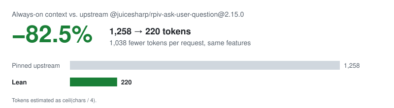

<div align="center">

# rpiv-ask-user-question-lean

**Let Pi ask you structured questions, with a much shorter tool prompt.**

[简体中文](https://github.com/kunkun9527/rpiv-ask-user-question-lean/blob/main/README_zh-CN.md) · Full setup: [My Lean Pi Setup](https://github.com/kunkun9527/my-lean-pi-setup)

</div>

<!-- token-benchmark:summary:start -->
<p align="center"></p>
<!-- token-benchmark:summary:end -->

A lean version of [`@juicesharp/rpiv-ask-user-question`](https://github.com/juicesharp/rpiv-mono/tree/main/packages/rpiv-ask-user-question). It runs the upstream `2.15.0` runtime as-is; I only condensed the tool description the model reads on every turn.

## Install

```bash
pi install npm:@ssk_dev/rpiv-ask-user-question-lean
```

Requires Pi `>=0.84.1` and Node.js `>=22.19.0`. Don't install it alongside upstream or another `rpiv-ask-user-question` wrapper, or the tool gets registered twice.

## Compared with upstream

**Kept**:

- The interactive questionnaire, option previews and RPC fallback.
- Single- and multi-select questions, recommendation ordering and strict option validation.

**Trimmed**: boilerplate in the tool description; runtime behavior is unchanged.

**Added**:

- **RPC hosts**: in RPC hosts (such as Codex through codexhost), questions become native option cards with back navigation, a review step and multi-select toggles. Those hosts can't show previews, so the RPC prompt tells the model not to send them.
- **Forgiving arguments**: before validation, a lone question sent flat, `header`/`options` left beside a one-item `questions`, or a missing `header` (derived from the question text) is repaired. Nothing is guessed when there are several questions.

## Usage

The model sees one tool, `ask_user_question`. It uses it when a requirement is unclear or you need to make a choice: each call asks 1–4 structured questions with 2–4 clear options each.

## Token comparison

<!-- token-benchmark:benchmark:start -->
With only this extension enabled, what the model reads on every turn:

| Variant | Breakdown | Total |
| --- | --- | ---: |
| Lean `@ssk_dev/rpiv-ask-user-question-lean@2.15.0` | `ask_user_question` (220) | **220** |
| Upstream `@juicesharp/rpiv-ask-user-question@2.15.0` | `ask_user_question` (1,258) | **1,258** |

<sub>Method: Pi 1.4.0, each variant measured in its own temporary process with an empty working directory and configuration. Built-in tools, skills, context files, session history, user messages, other extensions, runtime UI and slash commands are not counted; `before_agent_start` additions are. Tokens are estimated as `ceil(characters / 4)`, not billed tokens.</sub>
<!-- token-benchmark:benchmark:end -->

## Development

```bash
npm ci
npm run check
```

Tests run with a local harness and don't open the interactive questionnaire.

## License

MIT. The runtime comes from [`@juicesharp/rpiv-ask-user-question`](https://github.com/juicesharp/rpiv-mono/tree/main/packages/rpiv-ask-user-question) (MIT).
